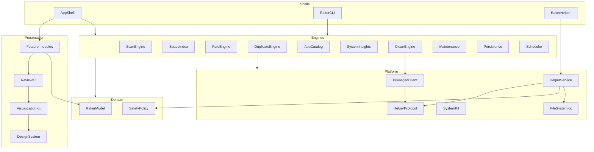
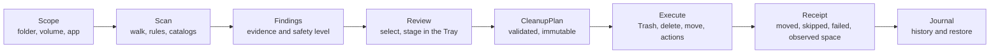
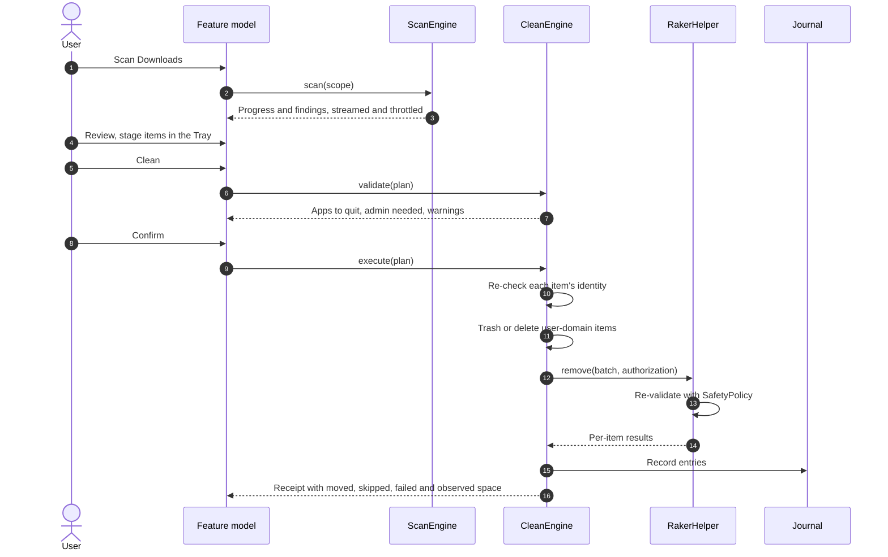

# Raker: Architecture

> **Status:** Proposal v0.1, for review before any code is written · **Date:** 2026-11-22
> **Scope:** a native macOS app that finds what uses storage, explains it, and removes what the user approves. Open source, and every feature is free.
> **Read with:** [`features.md`](features.md), the capability research and release scope this architecture implements.
> "Raker" is the working name, taken from the repository.

## Contents

1. [Summary and key decisions](#1-summary-and-key-decisions)
2. [Context, goals and constraints](#2-context-goals-and-constraints)
3. [System overview](#3-system-overview)
4. [Code structure](#4-code-structure)
5. [Core domain: the cleanup pipeline](#5-core-domain-the-cleanup-pipeline)
6. [Scanning and indexing](#6-scanning-and-indexing)
7. [Knowledge base: rule packs](#7-knowledge-base-rule-packs)
8. [Cleaning engine and safety](#8-cleaning-engine-and-safety)
9. [Permissions and privileged operations](#9-permissions-and-privileged-operations)
10. [Feature modules and the capability map](#10-feature-modules-and-the-capability-map)
11. [Experience architecture (UI/UX)](#11-experience-architecture-uiux)
12. [Concurrency and performance](#12-concurrency-and-performance)
13. [Persistence and data](#13-persistence-and-data)
14. [Security and privacy](#14-security-and-privacy)
15. [Dependencies](#15-dependencies)
16. [Testing](#16-testing)
17. [Build, release and distribution](#17-build-release-and-distribution)
18. [Observability and support](#18-observability-and-support)
19. [Roadmap](#19-roadmap)
20. [Risks and validation spikes](#20-risks-and-validation-spikes)
21. [Decisions needed from the owner](#21-decisions-needed-from-the-owner)

Appendices: [A. Glossary](#appendix-a-glossary) · [B. Info.plist and entitlements](#appendix-b-infoplist-and-entitlements) · [C. Helper XPC interface](#appendix-c-helper-xpc-interface)

A *spike* below is a short, time-boxed experiment in milestone M0 that must confirm an assumption before the design depends on it.

---

## 1. Summary and key decisions

Raker is a native macOS app written in **Swift 6** with **SwiftUI**, using AppKit where SwiftUI falls short. It ships outside the Mac App Store as a **Developer ID–signed, notarized** app (GitHub Releases, Homebrew cask, Sparkle updates), because whole-disk analysis, app removal and system-level tasks don't work inside the App Sandbox.

A single pipeline powers every feature: **scope → scan → findings → review → plan → execute → receipt**. Knowledge about what is safe to remove lives in **signed, declarative rule packs** that contributors can extend without writing Swift. Removal goes to the **Trash by default**, every action is journaled, and each cleanup reports separately what was selected, what moved, and how free space actually changed.

The interface is part of the architecture, not a skin applied at the end: a calm glass-and-light design (Liquid Glass on macOS 26 and later), visualizations that fill in live while a scan runs, one review surface where every item explains itself, and a receipt you can undo (§11).

### Decisions at a glance

| ID | Topic | Decision | See |
|---|---|---|---|
| D1 | Languages | Swift 6 everywhere: app, privileged helper, CLI, build tools. **Go isn't needed**; it's reserved for a server component if one is ever added. | §2.4 |
| D2 | UI stack | SwiftUI first; AppKit for very large tables and window details; Metal shaders for signature visuals. `@Observable` feature models, no UI framework dependency. | §11 |
| D3 | Minimum macOS | 15 Sequoia, the oldest version Apple still patches. Liquid Glass refinements on 26+. Tested on 15, 26 and 27, including 27.3's Full Disk Access changes. Universal binary. | §2.5 |
| D4 | Distribution | Developer ID + notarization; DMG on GitHub Releases, Homebrew cask, Sparkle 2. No Mac App Store build for now; the core stays edition-agnostic. | §2.6, §17 |
| D5 | Sandbox | Not sandboxed. Hardened runtime. Least privilege through permissions requested at the point of need. | §9 |
| D6 | Processes | One GUI process (window, menu bar, background jobs), an optional root helper registered with `SMAppService`, and a `raker` CLI. | §3 |
| D7 | Code layout | Monorepo: a thin Xcode project plus one local Swift package of focused modules. | §4 |
| D8 | Core model | Plan-centric: nothing is removed except through a reviewed, validated `CleanupPlan`. | §5 |
| D9 | Removal | Trash first. Permanent deletion only for data that apps rebuild, after explicit consent. Journal with restore. | §8 |
| D10 | Knowledge | YAML rules compiled into signed JSON packs. Rules can't run shell commands. Homebrew cask `zap` data imported. | §7 |
| D11 | Storage | SQLite through GRDB for history and settings data; compact compressed snapshots for disk trees. | §13 |
| D12 | Privacy | No telemetry, no accounts, works offline. Every network endpoint is listed and can be switched off. | §14 |
| D13 | License | Apache-2.0 with DCO sign-off recommended; the owner decides. | §21 |

---

## 2. Context, goals and constraints

### 2.1 Product thesis

From `features.md`: the first release helps someone who is running out of space find files they recognize, decide what to remove, and verify how much space came back. Later releases explain recurring growth, then add app, system and specialist tools. The owner adds two requirements: **advanced features are free** (no paid tier, no feature gating), and **the interface must be outstanding**.

### 2.2 Goals

1. **Safe by construction.** Bugs and bad rules must not destroy data. Personal files are never preselected. Every action is reversible, or labeled permanent before it runs.
2. **Understandable.** Every finding says what it is, why it was found, what happens if it's removed, and where it goes.
3. **Outstanding native experience.** Fluid at 120 Hz, beautiful in light and dark, fully accessible, unmistakably a Mac app.
4. **Fast.** Results stream in while scanning; a typical home folder takes seconds.
5. **Complete and free.** Covers the storage, app, developer and maintenance capabilities surveyed in `features.md`, without paywalls.
6. **Open and extensible.** Cleanup knowledge is data that contributors review and extend.
7. **Private.** Processing stays on the Mac. Nothing leaves it unless the user turns on a network feature.

### 2.3 Non-goals

| Not building | Reason |
|---|---|
| Antivirus, VPN, ad blocking, breach alerts | Different jobs that need their own evidence (`features.md`: separate product decision). |
| A "free up RAM" button | macOS manages memory. Raker shows memory pressure and the top consumers instead. |
| File shredding | Per-file secure erase isn't dependable on APFS and SSDs; FileVault is the real protection, and Raker says so. |
| Removing languages or CPU architectures from app bundles | Modifying signed bundles breaks code signatures and trips app-protection checks, for small gains. |
| Email inbox cleanup, browser tab management | Not local storage, and both need account access. |
| Windows or Linux versions | Mac only. The rule format stays language-neutral in case that ever changes. |
| A Mac App Store edition, for now | The App Sandbox can't support whole-disk and app cleanup. §2.6 keeps the option open. |

### 2.4 Language: Swift only, with Go reserved (D1)

| Need | Swift | Go |
|---|---|---|
| Native UI (SwiftUI, AppKit, Metal) | First-class | None; the UI would be Swift anyway |
| Apple frameworks: ServiceManagement, Security, Launch Services, Spotlight, Vision, Quick Look, FSEvents | Direct | Through cgo or Objective-C bridges |
| Fastest directory enumeration (`getattrlistbulk`) | Direct, through the Darwin module | Raw syscalls; the standard library walks with `readdir` plus one `stat` per file |
| Parallelism | Structured concurrency plus dedicated threads | Goroutines |
| Signing, notarization, universal binaries | One toolchain | A second toolchain and signing path |
| Contributors for Mac desktop work | Large pool | Small pool |
| Cross-platform reuse | Limited | Strong |
| Server software | Possible | Excellent |

**Decision.** Everything that ships in the app is Swift: UI, engines, privileged helper, CLI and rule tooling. A second language would add an IPC boundary, a duplicated domain model and a second build and signing pipeline without making anything faster. The expensive work is filesystem metadata I/O, and Swift reaches it through the same syscalls Go would.

**Where Go fits.** If Raker ever needs a backend, for example a rule-pack registry or an opt-in endpoint for "this finding was wrong" reports, that service would be written in Go and would consume the same JSON Schema the app uses. Releases R1–R4 don't need a backend: app updates and rule packs are static files on GitHub.

> Prior art: Mole, a popular open-source cleaner CLI, is written in Shell with Go for its concurrent disk analyzer. Raker gets the same concurrency in Swift, plus `getattrlistbulk`, which returns names, sizes and identifiers for a whole batch of directory entries in one call.

### 2.5 Minimum macOS 15 (D3)

Policy: support every macOS version Apple still ships security updates for when a major Raker version is released. In late 2026 that means macOS 27, 26 and 15.

- **What macOS 15 provides:** Observation (`@Observable`), the Synchronization module (`Mutex`, `Atomic`), Vision's Swift API (feature prints, aesthetics scores, face-capture quality), current SwiftUI APIs, and Swift Charts sector marks.
- **Who it includes:** Apple silicon Macs plus the 2018–2020 Intel Macs that run Sequoia, a large group of owners with small SSDs.
- **Newer APIs behind availability checks:** Liquid Glass (`glassEffect`, `GlassEffectContainer`, macOS 26) with material fallbacks, and Swift XPC peer requirements (`XPCPeerRequirement`, macOS 26). Until the minimum reaches 26, the helper uses `NSXPCConnection` code-signing requirements (macOS 13+).
- **Intel:** a universal binary for as long as macOS 15 and 26 Intel Macs are supported.

### 2.6 Distribution: Developer ID, outside the Mac App Store (D4)

`features.md` asks for this decision before committing to whole-disk cleanup.

- Whole-volume scanning, removing other apps, and root-level maintenance can't run inside the App Sandbox, which the Mac App Store requires. Raker ships signed with **Developer ID** and **notarized**.
- Notarization is effectively mandatory. macOS 15 removed the Control-click bypass for unsigned apps, Apple requires apps that contain `SMAppService` launch daemons to be notarized, and Homebrew requires casks to pass its Gatekeeper checks.
- An **Apple Developer Program** membership is required before the first public build.
- **Edition-agnostic core.** Every feature declares the access it needs (`AccessRequirement`), and an `AccessBroker` decides how to obtain it. Today that means macOS privacy permissions and the helper. Because the first release's scope (Downloads, user-selected folders, duplicates, Trash) also works with sandbox-style security-scoped bookmarks, a sandboxed App Store "Lite" edition could later be built from the same core.

### 2.7 Constraints

- Platform protections that shape the design: privacy permissions (TCC), System Integrity Protection, the sealed system volume, app bundle protection, Gatekeeper and notarization, and macOS 27.3's Full Disk Access changes (§9).
- A small open-source team: few dependencies, conventional technology, strong automated tests, written decisions.

### 2.8 Quality attributes, in priority order

When goals conflict, the higher one wins: **1. Safety · 2. Honesty · 3. Experience quality · 4. Performance · 5. Maintainability · 6. Extensibility.**

---

## 3. System overview

### 3.1 Context and processes

```mermaid
flowchart LR
    user(("User"))
    subgraph mac["The user's Mac"]
        app["Raker.app<br/>window, menu bar, background jobs<br/>runs as the user"]
        helper["RakerHelper<br/>launchd daemon, root<br/>optional, on demand"]
        cli["raker CLI<br/>runs in a terminal"]
        subgraph os["macOS"]
            vol[("APFS volumes")]
            tcc["Privacy permissions (TCC)"]
            ls["Launch Services"]
            md["Spotlight"]
            fse["FSEvents"]
            bg["Login items and background tasks"]
        end
    end
    subgraph net["Network: every endpoint optional"]
        feed["Raker updates<br/>Sparkle appcast on GitHub"]
        packs["Rule packs<br/>GitHub Pages"]
        appinfo["Third-party app versions<br/>Sparkle feeds, App Store lookup, Homebrew API"]
    end
    user --> app
    user --> cli
    app -- "XPC, code-signing checked" --> helper
    app --> vol
    helper --> vol
    cli --> vol
    app --> tcc
    app --> ls
    app --> md
    app --> fse
    app --> bg
    app -. "HTTPS" .-> feed
    app -. "HTTPS" .-> packs
    app -. "HTTPS, opt-in" .-> appinfo
```



| Process | Runs as | Lifetime | Does | Why it's separate |
|---|---|---|---|---|
| `Raker.app` | the user | while a window is open; optionally from login in menu-bar mode | UI, scans, user-domain cleanup, scheduling, menu-bar monitor, Trash watcher | — |
| `RakerHelper` | root | started by launchd when the app sends an XPC message; exits after 60 s idle | a short allow-list of privileged operations (§9.4) | privilege separation |
| `raker` | the user, or root through `sudo` | one command | scripting and automation on the same engines | headless use |
| Widgets (later) | sandboxed extension | managed by the system | desktop and Notification Center widgets | WidgetKit requires an extension |

**One GUI process, not a separate menu-bar agent (D6).** macOS attributes privacy permissions to an app's code identity. Keeping the window, menu-bar extra, scheduler and Trash watcher in one process means one Full Disk Access decision covers all of them, whereas a separate login-item app would need its own grants. When the last window closes, Raker saves what it needs, drops scan data, switches to the accessory activation policy (no Dock icon) and keeps only the menu-bar extra alive. Launch at login uses `SMAppService.mainApp`; spike S5 confirms starting directly in menu-bar mode.

### 3.2 Bundle layout

```text
Raker.app/Contents/
├── Info.plist
├── MacOS/
│   ├── Raker                       GUI app
│   └── RakerHelper                 privileged helper (BundleProgram of the daemon plist)
├── Helpers/
│   └── raker                       CLI; Homebrew or a Settings button links it into PATH
├── Library/LaunchDaemons/
│   └── app.raker.helper.plist      registered with SMAppService.daemon(plistName:)
├── Frameworks/
│   └── Sparkle.framework
├── PlugIns/                        later: widget extension
└── Resources/
    ├── Rules/base.rakerpack        signed baseline rule pack; works offline
    └── Assets.car, string catalogs, …
```

`app.raker` stands in for the bundle identifier prefix until the owner picks one (§21).

---

## 4. Code structure

### 4.1 Layers

```text
┌────────────────────────────────────────────────────────────────────────────────┐
│ Shells    Raker.app · raker CLI · RakerHelper                composition roots │
├────────────────────────────────────────────────────────────────────────────────┤
│ Features  Overview, Explore, Duplicates, Apps, …               SwiftUI screens │
│ UI kits   DesignSystem · VisualizationKit · ReviewKit                shared UI │
├────────────────────────────────────────────────────────────────────────────────┤
│ Engines   Scan, Index, Rules, Duplicates, Apps, Clean, …   domain logic, no UI │
├────────────────────────────────────────────────────────────────────────────────┤
│ Domain    RakerModel · SafetyPolicy                     pure types, invariants │
├────────────────────────────────────────────────────────────────────────────────┤
│ Platform  FileSystemKit · SystemKit · PrivilegedClient    only code calling OS │
└────────────────────────────────────────────────────────────────────────────────┘
```

1. Dependencies point downward only. Engines never import SwiftUI or AppKit.
2. Only platform modules call OS APIs. Engines receive them through protocols, so tests can use fakes and temporary folders.
3. `SafetyPolicy` has no dependencies and is linked into both `CleanEngine` and `RakerHelper`, so the app and the helper enforce identical rules independently.
4. Features depend on engine protocols injected by the shell, never on other features. Shared UI lives in the UI kits.
5. Engine APIs are `async`, cancellable, and report progress as values, never by calling back into UI code.
6. A module is created when its first feature lands; M0 starts with the subset R1 needs.

### 4.2 Module catalog

| Module | Layer | Responsibility | First needed |
|---|---|---|---|
| `RakerFoundation` | base | byte counts and formatting, path normalization, logging categories, async utilities, feature flags | M0 |
| `RakerModel` | domain | findings, plans, destinations, receipts, journal entries, access requirements, categories | M0 |
| `SafetyPolicy` | domain | deny-list, allowed roots, canonical path comparison, user exclusions and locked originals | M0 |
| `FileSystemKit` | platform | `getattrlistbulk` walker, volume information, clone-aware sizing, safe removal, Trash, FSEvents, cloud-file detection | M0 |
| `SystemKit` | platform | Launch Services, Spotlight, code signatures, Mach-O, process runner, `launchctl`, `pluginkit`, package receipts, access probes, system statistics | R1 |
| `HelperProtocol` | platform | XPC interface, Codable messages, operation risk tiers | R3 |
| `PrivilegedClient` | platform | `SMAppService` lifecycle, XPC connection, version handshake | R3 |
| `HelperService` | platform (root) | helper implementation, independent validation, authorization checks | R3 |
| `RuleEngine` | engine | rule schema, pack loading and Ed25519 verification, pattern matching, handler registry | R2 |
| `ScanEngine` | engine | scan sessions, traversal consumers, skipped-location reporting | M0 |
| `SpaceIndex` | engine | compact size tree, snapshots, diffs ("What grew?"), incremental refresh | R1 |
| `DuplicateEngine` | engine | exact duplicates, which-copy-stays strategies, folder comparison | R1 |
| `MediaSimilarity` | engine | similar and low-quality photos (Vision) | R4 |
| `AppCatalog` | engine | app inventory, associated files, leftovers, reset, update checks, Trash-watcher logic | R3 |
| `SystemInsights` | engine | System Data explainer, snapshots, device backups, Mail and Messages, background items, extensions | R2 |
| `BrowserAdapters` | engine | per-browser profiles and data categories | R4 |
| `CleanEngine` | engine | plan validation, execution, receipts, journal, restore | R1 |
| `Maintenance` | engine | typed maintenance and developer actions (DNS flush, `simctl`, `brew cleanup`, …) | R4 |
| `Persistence` | engine | GRDB database, migrations, repositories | R1 |
| `Scheduler` | engine | background jobs aware of power and thermal state | R2 |
| `DesignSystem` | presentation | tokens, typography, motion, components, glass with fallbacks | M0 |
| `VisualizationKit` | presentation | layouts (ring, sunburst, treemap, timeline) and Canvas or Metal renderers | R1 |
| `ReviewKit` | presentation | shared review list, inspector, Quick Look, the Tray | R1 |
| `Feature…` | presentation | one module per area: Overview, Explore, Duplicates, Clean, Apps, System, History, MenuBar, Onboarding, Settings, CommandPalette | R1 onward |
| `AppShell` | shell | composition root, dependency wiring, routing, scenes, menus, Sparkle, App Intents | M0 |
| `RakerCLI` | shell | the `raker` executable (swift-argument-parser) | M0 as a developer harness |
| `RuleTool` | tooling | `raker-rules`: compile, lint, test, sign, import Homebrew data | R2 |

### 4.3 Module dependencies



### 4.4 Repository layout

```text
raker/
├── README.md, LICENSE, NOTICE, CONTRIBUTING.md, SECURITY.md, CODE_OF_CONDUCT.md
├── docs/
│   ├── features.md                 capability research and release scope
│   ├── architecture.md             this document
│   └── adr/                        one file per architecture decision
├── App/
│   ├── Raker.xcodeproj             thin: app, helper and (later) widget targets
│   ├── Raker/                      @main, Info.plist, entitlements, assets, app icon
│   ├── RakerHelper/                main.swift, launchd plist
│   └── Config/                     .xcconfig files for signing and versions
├── Packages/RakerKit/
│   ├── Package.swift
│   ├── Sources/<Module>/
│   └── Tests/<Module>Tests/
├── Rules/
│   ├── schema/rule.schema.json     language-neutral contract
│   ├── packs/<category>/*.yaml     human-written rules
│   ├── fixtures/<rule-id>/         fixture trees and expected matches
│   └── i18n/
├── Design/                         tokens, icon sources, screen specs
├── Scripts/                        build, notarize, DMG, appcast
└── .github/workflows/              ci.yml, release.yml, rules.yml
```

Xcode's synchronized folders (Xcode 16 and later) keep `project.pbxproj` changes rare, so no project generator such as Tuist or XcodeGen is needed. The package builds and tests with plain `swift build` and `swift test`, which keeps CI fast and lets contributors work on engines without opening Xcode.

---

## 5. Core domain: the cleanup pipeline

### 5.1 One pipeline for every feature



Large files, Downloads, duplicates, app leftovers, caches and developer data are all producers of `Finding`s. They share one review surface (`features.md`: "the same review screen serves large files, old installers, and duplicate groups"), one validator and one executor. A new feature never adds a new way to delete files.

### 5.2 Core types (sketch)

```swift
public enum SafetyLevel: Int, Codable, Sendable, Comparable {
    case regenerable   // caches, logs, build output: the owning app recreates it
    case review        // personal data or a judgment call: never preselected
    case expert        // system-level or lossy: hidden unless Expert mode is on
}

public struct Finding: Identifiable, Codable, Sendable {
    public let id: FindingID
    public let subject: Subject              // .file(FileRef), .duplicateSet(SetID), .app(AppRef), .action(ActionRef)
    public let category: CategoryID          // "downloads.installers", "dev.xcode.derivedData", …
    public let safety: SafetyLevel
    public let size: SizeEstimate
    public let evidence: [Evidence]          // rule, age, download source, matched bundle ID, …
    public let explanation: LocalizedText    // what it is and what happens if it's removed
    public let constraints: [Constraint]     // .requiresQuit(app), .requiresHelper, .synced(provider), .notRestorable
    public let preselected: Bool             // true only for .regenerable items from trusted rules
}

public struct FileRef: Codable, Sendable, Hashable {
    public let path: FilePath
    public let identity: FileIdentity        // device, inode, size and mtime captured during the scan
    public let scope: RemovalScope           // .item, or .contents(ContentFilter) to empty a folder but keep it
}

public struct SizeEstimate: Codable, Sendable {
    public let logical: UInt64               // the size Finder shows
    public let allocated: UInt64             // blocks on disk; smaller for sparse and compressed files
    public let reclaimable: UInt64?          // freed immediately on deletion; nil when unknown
}

public enum Destination: Codable, Sendable {
    case trash                               // default for anything not regenerable
    case delete                              // regenerable data, after explicit consent
    case move(to: FilePath)                  // for example, setting duplicates aside in a folder
    case removeDownload                      // iCloud Drive: keep the cloud copy, free the local one
    case action(ActionID)                    // typed maintenance or developer action
}

public struct CleanupPlan: Codable, Sendable {
    public let id: PlanID
    public let items: [PlanItem]             // finding plus destination
    public let spaceBefore: VolumeSpace      // measured when the plan is created
}
```

### 5.3 Honest space accounting

`features.md` asks Raker to report "the size of selected files, the amount moved to Trash, and the observed change in available space separately". APFS makes naive sums wrong, so the model tracks each effect explicitly.

The key primitive is APFS **private size** (`ATTR_CMNEXT_PRIVATESIZE`, read through `getattrlistbulk`): the bytes "not trapped inside a clone or snapshot, and which would be freed immediately if the file were deleted". Summed over a selection, it's the honest reclaimable estimate.

| Effect | What goes wrong naively | How Raker handles it |
|---|---|---|
| APFS clones share blocks | Deleting one copy frees little or nothing | Private size, plus `ATTR_CMNEXT_CLONE_REFCNT` and `URLResourceKey.fileContentIdentifierKey` / `mayShareFileContentKey` to label duplicate sets as "already space-efficient" |
| Hard links | The same data appears under several paths | Each (device, inode) pair counts once |
| Sparse and compressed files | Logical size far above disk use (VM disks, `Docker.raw`) | Allocated size is the primary number |
| Local Time Machine snapshots | Removed data stays referenced until snapshots expire | Private size excludes snapshot-trapped bytes; the receipt explains the gap; System Data lists snapshots |
| Purgeable space | macOS already counts it as available | Free space and "available including purgeable" (`volumeAvailableCapacityForImportantUsage`) shown separately |
| Trash | Moving to Trash frees nothing until it's emptied | The receipt separates "moved to Trash" from "freed" and offers to empty the Trash |
| Dataless cloud files | Large in the cloud, almost nothing on disk | Allocated size, plus separate synced-file handling (§8.5) |
| Other disk activity | Apps write while Raker cleans | The change is labeled "observed" and measured before and after, with a short settling period |

### 5.4 From scan to receipt



---

## 6. Scanning and indexing

### 6.1 BulkWalker

- **One syscall per batch.** `getattrlistbulk(2)` on a directory descriptor returns many entries at once, each with name, type, inode, flags, logical and allocated size, dates, link count and mount status. With `FSOPT_ATTR_CMN_EXTENDED` it can also return APFS private size and clone counts (spike S6 confirms support on each volume type). That avoids the per-file `stat` calls and object allocations of `FileManager` enumeration and `readdir`-based walkers.
- **Descriptor-relative and symlink-safe.** Directories are opened with `openat(…, O_DIRECTORY | O_NOFOLLOW)`. The walker never follows symlinks, isn't limited by path length, and doesn't cross mount points unless the scope includes them (`ATTR_DIR_MOUNTSTATUS`).
- **Dedicated threads.** A pool of worker threads (the performance-core count by default, fewer for rotational and network volumes) takes directories from a work-stealing queue. Blocking syscalls never run on Swift's cooperative thread pool, so UI tasks are never starved.
- **Sizes bubble up while scanning.** Each directory tracks its pending children; when the count reaches zero, its totals propagate to the parent. Folder sizes appear progressively.
- **Cancellable at any time.** Workers check a flag per batch. Partial results stay valid and are labeled partial.
- **Named gaps.** Every unreadable location becomes a `SkippedLocation` with a reason (privacy area, root-only, SIP-protected, I/O error) and the fix, so Raker can "name any skipped locations" as `features.md` requires.
- **Never reads contents.** The walk touches metadata only, so it can't trigger downloads of iCloud or File Provider files that aren't on the Mac (`SF_DATALESS`).
- **Packages as items.** Bundles such as `.app` and `.photoslibrary` are measured completely but shown as one item unless the user expands them (`features.md`: "treat an app package as a single item").
- **Volume-aware.** On the startup disk the walker covers the Data volume once (firmlinks would otherwise double-count `/Users` and other folders), reports the sealed system volume as a single "macOS" entry, and skips other mounts unless they're selected.

### 6.2 One walk, many consumers

The walker feeds batches to registered consumers on its worker threads. Each consumer keeps per-thread state and merges at the end.

| Consumer | Produces | Used by |
|---|---|---|
| `TreeBuilder` | compact size tree | Largest items, Space Lens, What grew |
| `LargestItems` | top-N files per kind | Large and old files |
| `DownloadsClassifier` | installers, archives, disk images, media, screenshots | Downloads and installers |
| `DuplicateCandidates` | files grouped by size | Duplicates |
| `ProjectArtifacts` | `node_modules`, `DerivedData`, `.build`, `target`, `.venv` in inactive projects | Developer storage |
| `RuleMatcher` | rule matches inside the walked scope | Caches and logs |

Rule-based cleanup (caches, logs, developer caches) doesn't walk the disk. It evaluates only rule roots such as `~/Library/Caches/*`, so it finishes in seconds.

### 6.3 Metadata that makes files recognizable

Recognition is the heart of the first release, so findings carry context beyond name and size:

- **Where a download came from:** the `com.apple.metadata:kMDItemWhereFroms` and `com.apple.quarantine` extended attributes, read directly ("from docker.com, via Safari").
- **When it was last opened:** Spotlight's `kMDItemLastUsedDate`, falling back to file dates when Spotlight has nothing.
- **Screenshots:** Spotlight's `kMDItemIsScreenCapture` and the screenshot-location setting.
- **"App already installed"** for installers: disk-image, package and archive names matched against the app catalog by name and version.
- **Thumbnails and icons:** Quick Look thumbnails and real app icons in every list.

Spotlight results are hints. Each one is confirmed on disk before display, and every feature still works when Spotlight indexing is off.

### 6.4 Snapshots and "What grew?"

- After a full scan of a scope, `SpaceIndex` saves a snapshot: folder tree, sizes, item counts, date, volume UUID and the current FSEvents event ID.
- History snapshots keep folders above a threshold (10 MB by default), so each is tens of kilobytes to a few megabytes, compressed with Apple's Compression framework.
- **Diff:** comparing two snapshots by path ranks the folders that grew or shrank most, lists new large items, and totals the change per category.
- **Incremental refresh:** FSEvents, replayed from the stored event ID, names the directories that changed, and only those are rescanned. If FSEvents reports lost history (`MustScanSubDirs` or dropped events), Raker does a full scan.
- **Retention:** daily snapshots for 30 days and weekly snapshots for 6 months, configurable.

### 6.5 Performance budgets

The baseline machine is an M1 MacBook Air with an internal SSD, the oldest Apple silicon. CI benchmarks on synthetic trees enforce these budgets.

| Scenario | Budget |
|---|---|
| Launch to interactive window | < 1 s |
| Scan Downloads (10,000 items) | < 1 s |
| Rule-based cache scan | < 5 s typical |
| Home folder with 1 million entries, warm cache | < 10 s |
| The same, cold cache | < 40 s |
| Memory for a 1-million-entry tree | < 150 MB |
| UI while scanning | 120 Hz on ProMotion displays, no main-thread stall over 8 ms |
| Menu-bar mode, idle | < 0.5 % CPU on average, < 60 MB of memory |

---

## 7. Knowledge base: rule packs

### 7.1 Why knowledge is data

Hundreds of apps and tools keep their own caches, logs and leftovers, and the details change faster than app releases. Raker keeps that knowledge in reviewed YAML files, compiles them into a signed pack, verifies the signature before use, and can update packs without an app release.

### 7.2 Examples

```yaml
# Rules/packs/browsers/google-chrome.yaml
schema: 1
id: browser.chrome
app: { name: Google Chrome, bundleIds: [com.google.Chrome] }
verified: { macOS: ["15.7", "26.4", "27.2"] }
items:
  - id: browser.chrome.cache
    title: Cache
    explanation: >
      Copies of pages and images Chrome keeps to load sites faster.
      Chrome downloads them again when needed.
    category: caches.browsers
    safety: regenerable
    whileRunning: skip               # skip | requireQuit | allow
    targets:
      - path: "~/Library/Caches/Google/Chrome/*/Cache"
        remove: contents             # contents | item
      - path: "~/Library/Caches/Google/Chrome/*/Code Cache"
        remove: contents
```

```yaml
# Rules/packs/developer/xcode.yaml (excerpt)
  - id: dev.xcode.derivedData
    title: Xcode build data (DerivedData)
    explanation: Intermediate build products. Xcode recreates them; the next build takes longer.
    category: developer.xcode
    safety: regenerable
    whileRunning: requireQuit
    processes: [com.apple.dt.Xcode]
    targets:
      - path: "~/Library/Developer/Xcode/DerivedData/*"
        remove: item
        olderThan: 14d
  - id: dev.xcode.simulators.unavailable
    title: Simulators for runtimes that are no longer installed
    category: developer.xcode
    safety: regenerable
    action: { handler: simctl.deleteUnavailable }   # built-in Swift handler; rules can't run commands
    requires: { tool: xcrun }
```

### 7.3 Semantics

- **Variables:** `~` (the current user's home, injected so tests can use a fake home), `$DARWIN_USER_CACHE_DIR` and `$DARWIN_USER_TEMP_DIR` (from `confstr`), and `$APP(bundle-id)` (where an app is installed).
- **Patterns:** `*`, `**`, `?` and `{a,b}`. Matching follows the volume: case- and Unicode-normalization-insensitive on the default case-insensitive APFS format.
- **Filters:** `olderThan`, `largerThan`, `kind`, `exclude`.
- **Conditions:** `ifInstalled` and `ifNotInstalled` (bundle IDs), `requires.tool` (resolved from known absolute paths, never from `PATH`), a macOS version range, and CPU architecture.
- **Safety:** `regenerable` may be preselected, `review` never is, and `expert` stays hidden unless Expert mode is on.
- **Actions:** removal with a destination, or a built-in handler referenced by ID with typed parameters. **Rule packs can't contain shell commands or define new handlers.**
- **Confinement:** rules may only target allowed roots (the user Library, per-user cache and temp folders, known tool caches in the home folder, `/Library/Caches`, `/Library/Logs`, and so on). The compiler and the app both enforce `SafetyPolicy`.
- **Kill switch:** a pack can disable any rule by ID, so a misbehaving rule can be switched off without an app release.

### 7.4 Packaging, signing and updates

- `raker-rules compile` validates every file against `Rules/schema/rule.schema.json` (JSON Schema, which any language can consume), lints it, runs its fixtures, and emits `rules.json` plus string catalogs for translators.
- `raker-rules sign` signs the canonical bytes with Ed25519 (CryptoKit). The manifest carries the pack version (CalVer, for example `2026.11.2`), the minimum app version and the key ID.
- The app embeds two public keys (current and next) so keys can rotate. Packs come from GitHub over HTTPS; the app verifies a pack, then activates it atomically. On any failure it keeps the last good pack, and the signed baseline inside the app always works offline.
- Channels: `stable` and `beta`. The app checks at most once a day, sends nothing beyond a plain HTTPS request, and users can turn checking off.

### 7.5 Contribution workflow

A pull request adds or changes YAML plus fixtures. CI validates the schema, lints (denied or out-of-root paths, missing explanations, unjustified `regenerable`, duplicate IDs) and runs fixture tests in a temporary home folder. A maintainer for that category reviews it (CODEOWNERS). After merge, a protected release workflow signs it and publishes to `beta`, and a maintainer later promotes it to `stable`.

### 7.6 Imported knowledge: Homebrew `zap` data

Homebrew's cask API (`formulae.brew.sh/api/cask.json`) describes thousands of Mac apps: the bundle IDs to quit, the launchd labels and package receipts to remove on uninstall, and curated `zap` lists of support files. `raker-rules import-homebrew` turns these into `apps.homebrew` rules when the pack is built. Homebrew's cask repository is BSD-2-Clause licensed, so attribution goes in `NOTICE`. The uninstaller treats these paths as strong evidence (§10.4). Users don't need Homebrew installed.

---

## 8. Cleaning engine and safety

### 8.1 Defense in depth

| # | Layer | Where | What it guarantees |
|---|---|---|---|
| 1 | Rule checks | CI | Rules can't target denied or out-of-root paths, and each must explain itself. |
| 2 | Finding policy | Scan | Personal files are never preselected, synced files are flagged, and locked originals are excluded. |
| 3 | Human review | UI | Each item shows its path, size, date, reason and destination (`features.md`). |
| 4 | Plan validation | `CleanEngine` | Deny-list, at least one kept copy per duplicate set, running apps, required access. |
| 5 | Just-in-time re-check | Executor | Each item's device, inode, size and mtime must still match the scan; otherwise it's skipped as "changed since scan". |
| 6 | Safe removal primitive | `FileSystemKit` | Descriptor-relative deletion (`openat`/`unlinkat`, `O_NOFOLLOW`): no symlink following, no mount crossing. |
| 7 | Independent helper check | `RakerHelper` | The helper re-runs `SafetyPolicy` itself and never trusts the app's checks. |
| 8 | Reversibility | Journal | Trash by default, original paths journaled, restore while items remain in the Trash. |

### 8.2 SafetyPolicy

`SafetyPolicy` lives in code, not in rule packs, and the app and the helper share it.

- **Never removable:** `/System`, `/usr` (except `/usr/local`), `/bin`, `/sbin`, `/private/var/db`, the sealed system volume, `~/Library/Keychains`, Photos library internals, the Mail and Messages databases, the iCloud Drive root, home-folder and volume roots, and other users' home folders.
- **Selection only:** folders such as `~/Documents` and `~/Desktop` are never rule targets. Their contents can be removed only after the user selects them.
- **Canonical paths:** resolve `..`, repeated separators and firmlinks, then compare case- and normalization-insensitively. On default APFS, `/SYSTEM` is `/System`.
- **Ownership:** the app removes user-owned items as the user. Root-owned items go only through the helper's allow-listed operations.
- **User rules:** exclusions and locked originals are part of the policy, so no plan can include them.
- **Testing:** property-based tests and a canary suite (§16).

### 8.3 Execution

- Plan → validation report (blocking problems, warnings, apps to quit, items needing the helper) → confirmation sheet → streamed progress → receipt.
- Order of work: quit apps (politely, and force only after asking) → user-domain removals → one helper batch with one authorization → actions → space measurement.
- Removal runs with bounded parallelism per volume; Trash moves are serialized per volume.
- A failed item never aborts the plan. It's recorded with its reason and a suggested fix.

### 8.4 Destinations

| Destination | Used for | Undo |
|---|---|---|
| Trash (`FileManager.trashItem`) | everything not regenerable: personal files, installers, duplicates, apps | Restore from History while the item is in the Trash |
| Permanent deletion | regenerable caches, logs and build output, after consent ("These rebuild automatically. Skip the Trash?") | None, and the confirmation says so |
| Move to folder | setting duplicates aside (`features.md`) | Move back |
| Remove download | iCloud Drive files (`FileManager.evictUbiquitousItem`) | The file downloads again when opened |
| Helper holding area | root-owned app components (launch daemons, helper tools, receipts), kept for 7 days | Restore through the helper |

The Trash folder itself is privacy-protected, so spike S1 settles how restore and emptying work without Full Disk Access. The fallback is Finder automation, requested only at that moment.

### 8.5 Synced files

- **Detection:** location (`~/Library/Mobile Documents`, `~/Library/CloudStorage/…`, iCloud-synced Desktop and Documents), `URLResourceKey.isUbiquitousItemKey`, download status, and the `SF_DATALESS` flag.
- **First release:** synced files are explained, never removed. Deleting a synced file deletes it on every device, so Raker offers "Show in Finder" and points to the provider's own local-storage control instead (`features.md`).
- **Later:** iCloud Drive "Remove Download" through `evictUbiquitousItem`, and deletion from the cloud as a separate, explicitly confirmed action.
- **Hashing safety:** duplicate-hashing threads set the `IOPOL_TYPE_VFS_MATERIALIZE_DATALESS_FILES` I/O policy to `OFF`, so an accidental read fails instead of downloading the file.

### 8.6 Journal and restore

Each executed item records the plan, finding, rule or source, original path, destination (Trash location, folder, or deleted), identity, sizes, time and outcome. History groups entries by cleanup. Restore moves items back when the original location is free and asks otherwise (rename, or choose a folder). Entries are marked expired once their Trash items are gone.

---

## 9. Permissions and privileged operations

### 9.1 Principles

1. **Useful with no special permission.** Downloads and user-selected folders work on first launch (`features.md`).
2. **Ask at the point of need**, explaining exactly what the permission unlocks.
3. **Prefer narrow grants.** On macOS 27.3 and later, users can give an app Full Disk Access to specific protected folders or apps only, and Raker tells them which areas each feature needs.
4. **Degrade per location.** Unreadable areas are listed as skipped, each with an explanation and a one-click fix.
5. **Request nothing unused.** No Accessibility, Input Monitoring or Screen Recording. Spike S3 checks whether removing other developers' apps requires app-management access or System & App Protection Override.

### 9.2 Permission matrix

| Permission | Unlocks | Asked when | How Raker knows |
|---|---|---|---|
| Files & Folders: Downloads, Desktop, Documents | scanning those folders (usage strings in Info.plist) | first scan of that folder | system prompt; probe |
| Folders chosen in an Open panel or dropped on the window | scanning anything the user picks | user action | implicit consent |
| Removable and network volumes | external drives and shares | when selected | system prompt |
| Full Disk Access (whole disk, or specific areas on 27.3+) | Library-wide caches and logs, Mail, Safari and Messages data, other apps' containers, device backups, the Trash | when the user opens a feature that needs it | probing protected locations (there's no API) |
| App bundle protection ("App Management") | removing apps from other developers | first uninstall | operation error and guided fix (spike S3) |
| Background item approval | privileged helper, launch at login | first privileged task; turning on launch at login | `SMAppService.status` |
| Notifications | low-space alerts, scheduled results, Trash watcher | turning those on | `UNUserNotificationCenter` |
| Photos (later) | duplicates inside the Photos library, through PhotoKit | that feature | PhotoKit authorization |
| Automation of Finder (fallback only) | Trash restore or emptying, if direct access is denied | first such action | Apple Events result |

### 9.3 Access Center

- `AccessMap` tracks each protected area (Downloads, Desktop, Documents, Mail, Safari, Messages, other apps' containers, Trash, device backups, removable and network volumes) as granted, denied or unknown. Probes are non-prompting reads, such as `open(O_RDONLY)` on a known item, where `EPERM` means denied. The map refreshes whenever Raker becomes active.
- Rules and features declare `AccessRequirement`s, and the rule engine derives them from rule paths. Locked findings say what they need ("Needs access to Mail data"), and Settings has one Access Center that lists every area, its state and what it unlocks.
- macOS 27.3 lets users scope Full Disk Access to specific folders and apps, and there's still no API to check or request it. The Access Center therefore shows which areas each feature needs, includes an illustrated guide for each macOS version, detects a new grant automatically and continues. Beta reports suggest 27.3 no longer opens that pane by URL, so deep links into System Settings are treated as best-effort.

### 9.4 Privileged helper

- **Registration:** `SMAppService.daemon(plistName: "app.raker.helper.plist")`. The plist in `Contents/Library/LaunchDaemons` names `BundleProgram`, `MachServices` and `AssociatedBundleIdentifiers` (Appendix B). The user approves it under System Settings → General → Login Items & Extensions; Raker opens that pane with `SMAppService.openSystemSettingsLoginItems()` and watches `status`.
- **Just in time:** the helper is registered the first time the user chooses something that needs root. Many users never will.
- **Transport:** `NSXPCConnection` to the Mach service with the `.privileged` option. The client calls `setCodeSigningRequirement` so it only talks to a helper signed by Raker's team; the helper calls `setConnectionCodeSigningRequirement` so it only accepts Raker.app with that team and identifier. These checks use the caller's audit token, avoiding the process-ID races behind past helper vulnerabilities in other products. Once the minimum OS is 26, this can move to Swift's `XPCSession` and `XPCListener` with `XPCPeerRequirement.isFromSameTeam(andMatchesSigningIdentifier:)`.
- **Messages:** versioned Codable payloads (Appendix C).
- **Updates:** Apple requires a daemon to be re-registered when its executable changes. After a Sparkle update, the version handshake detects the mismatch and Raker unregisters and re-registers the helper.
- **Lifetime:** launched on demand; exits after 60 s idle.
- **Privacy attribution:** Apple's developer technical support has described the app as the responsible code for an `SMAppService` daemon; spike S4 verifies what that means for privacy checks. The design doesn't depend on it, because the helper only works on system paths that aren't privacy-protected.

| Operation | Risk | Extra authorization |
|---|---|---|
| `measure(paths)`: sizes only, for root-only folders (System Data accounting) | low | none |
| `removeSystemCaches(items)` inside `/Library/Caches`, `/Library/Logs` and `/private/var/log` | low | none |
| `flushDNSCache()` | low | none |
| `reindexSpotlight(volume)` | medium | administrator, once per session |
| `removeAppComponents(items)`: launch daemons, privileged helper tools, root-owned app bundles, package receipts | high | administrator, per plan |
| `bootoutDaemon(label)` | high | administrator, per plan |
| `deleteLocalSnapshot(date)` (expert, later) | high | administrator, per operation |

High-risk operations need a fresh administrator authorization (Authorization Services) that the app obtains and the helper verifies, so nothing can silently remove another product's daemon through Raker. No operation accepts paths outside its allow-list, and none runs arbitrary commands.

**The CLI never talks to the helper.** Otherwise any local process could run Raker's signed CLI to reach root operations. Root-level CLI tasks require `sudo raker …` and apply the same `SafetyPolicy`.

---

## 10. Feature modules and the capability map

### 10.1 Storage exploration

- **Scope picker:** Downloads (the default), Home, a chosen folder, a whole volume, external and network volumes. The scope determines which permissions are requested.
- **Largest items:** the size tree as a ranked, drillable list with proportional bars, kinds, last-opened dates and download sources. Filters for name, kind, size and age; hidden files on request; packages as single items. It stays useful when a folder holds thousands of small files.
- **Space Lens:** the same tree as a sunburst, with a treemap alternative, zoom, coloring by kind, age or safety, and drag-to-Tray (§11.5).
- **System Data explainer:** attributes known contributors (local snapshots, swap and sleep image, caches, logs, device backups, simulator runtimes, VM and container disks, Mail downloads), measures root-only areas through the helper's `measure`, and shows unaccounted or inaccessible space as its own segment (`features.md`).
- **What grew:** snapshot diffs and a usage timeline (§6.4), with optional "tell me if this grows again" alerts.

### 10.2 Everyday clutter

- **Downloads and installers:** disk images, packages, `.xip` files and archives, flagged "app already installed" when that's true, plus known chat-app download folders. Personal archives are never preselected, because they may be the only copy (`features.md`).
- **Large and old files:** size and last-opened thresholds per kind (video, audio, archives, disk images, documents, VM images).
- **Screenshots and downloaded media:** screenshots grouped by month; TV, Music and Podcasts downloads shown with the owning app's own removal control.
- **Caches and logs:** rule packs per app and system area (§7), showing the owner and what rebuilds.
- **Trash across locations:** the user's Trash and each external volume's `.Trashes/<uid>` folder; Mail's trash appears as information only.
- **Device backups and firmware:** iPhone and iPad backups with device name, model, OS version and date from each backup's `Info.plist`, plus downloaded `.ipsw` files, so a backup worth keeping is recognizable.
- **Mail and Messages:** sizes per account and per conversation store. Actions appear only where the account type makes them safe, such as downloaded copies of IMAP attachments; otherwise Raker points to the app's own setting.
- **Document versions and account remnants:** shown for individual review only. Former users' home folders and the archives in `/Users/Deleted Users` need the helper.
- **Cloud storage:** the local footprint of iCloud Drive and File Provider folders, and "Remove Download" for iCloud Drive. Remote quotas and provider APIs are out of scope.

### 10.3 Duplicates and photos

- **Pipeline:** size groups from the walk → a hash of the first and last 16 KB → a full SHA-256 (CryptoKit) using large sequential reads and `F_NOCACHE`, so the user's file cache isn't evicted. Hard links collapse to one file, and APFS clones are labeled as already sharing space.
- **Which copy stays:** strategies (preferred folders ranked by the user, oldest, newest, shortest path, names without "copy" or "(1)") applied to all sets with a live preview. Locked originals always stay. **A set can never be fully selected**, and the model enforces it.
- **Re-verification:** before acting, each file's size and mtime are checked again; anything that changed is re-hashed or skipped.
- **Folders:** identical folder trees are found with Merkle hashes (a hash over sorted names and content hashes). Comparison ships in R3; merging comes later.
- **Similar and low-quality photos (R4):** Vision feature-print distance with a perceptual-hash prefilter, bursts grouped by capture time, and Vision's aesthetics and face-capture-quality scores to suggest the best shot and flag utility images such as photographed receipts. The user decides; nothing is preselected.
- **Photos library (later):** through PhotoKit only, so removals go to Recently Deleted for 30 days. Raker never touches the library package directly.

### 10.4 Applications

- **Inventory:** apps found through Launch Services, Spotlight and standard folders, with size, last opened, source (App Store receipt, Homebrew cask, Setapp, direct download), signing team and architecture. Intel-only apps are flagged, because macOS 27 is the last release with full Rosetta 2 support.
- **Associated files:** identity tokens (bundle ID, team ID, app-group IDs from the app's entitlements, embedded helpers and login items, `SMPrivilegedExecutables`, package receipts) are matched across about 40 Library locations in the user and system domains, the per-user cache and temporary folders, and launchd plists. Every match gets a confidence score:

  | Evidence | Confidence | Preselected |
  |---|---|---|
  | Exact bundle ID, Homebrew `zap` path, or package-receipt file list | high | yes |
  | Team-prefixed app group or embedded helper ID | high | yes |
  | Bundle-ID prefix, or a vendor folder with no other installed app from that vendor | medium | no |
  | Name match only | low | no, and hidden unless requested |

  Anything that also matches another installed app is marked "shared" and never preselected. Apple's own items are excluded unless the app being removed is an Apple app.
- **Uninstall:** quit the app → unload its agents → remove files (the bundle and user files to the Trash, root-owned components through the helper) → forget package receipts → journal. When a rule knows a vendor uninstaller exists, Raker recommends it first.
- **Reset:** remove preferences, caches and saved state but keep the app.
- **Leftovers:** the inverse search, for Library items whose identifiers match no installed app, scored the same way and never preselected below high confidence.
- **Trash watcher:** watches the Trash with FSEvents. When an app lands there, a notification offers to review its leftovers.
- **Startup and background items:** launchd plists in the user and system domains, their loaded state from `launchctl`, the owning app, and signature and notarization status; items whose executable is missing are flagged. Disable or remove them through `launchctl` (system-domain items through the helper). Items that other apps registered with `SMAppService` are managed in System Settings, which Raker opens.
- **Extensions and plug-ins:** app extensions through `pluginkit` (Safari, Finder, Share, Quick Look), legacy plug-in folders (preference panes, screen savers, Spotlight importers, audio plug-ins, input methods), and browser extensions per profile.
- **Updates (R4, opt-in):** compares installed versions with each app's Sparkle feed (`SUFeedURL`), the App Store lookup API for App Store apps, and Homebrew's cask API. Raker shows release notes in a script-free view, lets users skip versions, and hands installation to the app's own updater, the App Store or `brew upgrade --cask`. It's off until enabled, because each check tells those servers which apps are installed.

### 10.5 Developer storage (R4)

Findings are grouped by tool, so a developer can weigh the cost of rebuilding or downloading again (`features.md`).

| Tool | Examples | Default safety |
|---|---|---|
| Xcode | DerivedData, unavailable simulators (`simctl`), old device support, previews | regenerable |
| Xcode archives | `~/Library/Developer/Xcode/Archives` | review: archives hold the symbols for shipped builds |
| Package managers | Homebrew downloads (`brew cleanup`), npm, Yarn, pnpm, pip, Gradle, CocoaPods, SwiftPM, the Go build cache | regenerable |
| Go module cache | read-only files, removed the way `go clean -modcache` does it | regenerable |
| Containers and VMs | Docker build cache and dangling images (through the `docker` CLI when present), Android emulators, VM disks | review |
| AI tools | model weights (`~/.ollama/models`, the Hugging Face cache), kept separate from caches and logs | review: slow to download again |
| Projects | `node_modules`, `.build`, `target`, `.venv` in projects untouched for N days | review |

Handlers run as the user with absolute tool paths, argument arrays (no shell), timeouts and streamed output.

### 10.6 System and maintenance (R3–R4)

- **Maintenance tasks:** flush the DNS cache, rebuild a volume's Spotlight index, rebuild the Launch Services database, speed up Mail's index (with Mail quit), and verify the startup volume read-only. Each task states what it does, how long it takes and whether it needs administrator rights.
- **Snapshots and purgeable space:** listed and explained in R3. Deleting snapshots is a later expert action, because it gives up a local restore point that macOS already manages.
- **Finder and Dock tweaks (later):** reversible `defaults` changes with a reset button.

### 10.7 Monitoring and automation

- **Menu-bar storage monitor (R2):** available space, 7-day trend, Trash size, low-space alert threshold, quick actions.
- **System monitor (R4):** CPU, memory pressure with the top consumers, network throughput, and battery cycle count and health, all from public APIs and sampled only while visible. Temperatures and fans come later as a best-effort module isolated from the rest, because they depend on undocumented sensors.
- **Scheduling:** reminders and scheduled scans notify the user and never remove anything on their own, unless the user creates an explicit rule limited to `regenerable` items.
- **Integrations (R4):** App Intents for Shortcuts and Spotlight ("Scan Downloads", "Free space", "Empty Trash"), Finder Services ("Uninstall with Raker", "Show in Space Lens"), the `raker` CLI with JSON output, and `raker://` deep links.

### 10.8 Capability map

Every capability in `features.md`, where it lives, and when it ships. Releases are defined in §19; "No" marks a deliberate non-goal.

| # | Capability (`features.md`) | Module | Release | Access beyond defaults |
|---|---|---|---|---|
| 1 | Guided scan | FeatureOverview, ScanEngine | R1, growing each release | — |
| 2 | Largest files and folders | FeatureExplore, SpaceIndex | R1 | — |
| 3 | Visual disk map | FeatureExplore (Space Lens), VisualizationKit | R2 (`features.md`: next expansion) | — |
| 4 | Scope and volume selection | ScanEngine, AppShell | R1 folders · R2 whole disk · R3 external and network · cloud accounts: No | removable and network volumes |
| 5 | Filters and hidden files | FeatureExplore | R1 | — |
| 6 | Explain "System Data" and gaps | SystemInsights, HelperService | R3 | Full Disk Access; helper for root-only sizes |
| 7 | Historical growth and alerts | SpaceIndex, Scheduler | R2 | notifications |
| 8 | Menu bar storage monitor | FeatureMenuBar | R2 | notifications |
| 9 | Caches, logs and temporary files | RuleEngine, FeatureClean | R2 | Full Disk Access for some areas; helper for system logs |
| 10 | Old downloads and installers | ScanEngine (DownloadsClassifier), FeatureExplore | R1 | Downloads folder |
| 11 | Large and old personal files | ScanEngine (LargestItems), FeatureExplore | R1 | — |
| 12 | Screenshots and downloaded media | ScanEngine, SystemInsights | R2 | — |
| 13 | Mail and Messages attachments | SystemInsights | R3, information first | Full Disk Access (Mail, Messages) |
| 14 | Old iPhone and iPad data | SystemInsights | R2 | Full Disk Access |
| 15 | Trash across locations | FeatureClean, CleanEngine | R2 | Full Disk Access or Finder automation (S1) |
| 16 | Document versions and account remnants | SystemInsights | R3, review only | helper |
| 17 | Cloud storage and local downloads | FileSystemKit, CleanEngine | R1 explain · R3 iCloud Remove Download · remote quotas: No | — |
| 18 | Email inbox cleanup | — | No | — |
| 19 | Exact duplicate files | DuplicateEngine, FeatureDuplicates | R1 | — |
| 20 | Choose which copy survives | DuplicateEngine, ReviewKit | R1 | — |
| 21 | Compare and merge folders | DuplicateEngine | R3 compare · later merge | — |
| 22 | Near-duplicate and poor-quality photos | MediaSimilarity | R4 | Photos, for the library only |
| 23 | Media-library support | MediaSimilarity | later: Apple Photos through PhotoKit · other catalogs: No for now | Photos |
| 24 | New duplicate alerts | DuplicateEngine, Scheduler | later | notifications |
| 25 | Folder rules and filing | RuleEngine (user rules), Scheduler | later | — |
| 26 | App inventory and uninstall | AppCatalog, FeatureApps | R3 | Full Disk Access, app bundle protection, helper |
| 27 | Leftovers and app reset | AppCatalog | R3 | Full Disk Access |
| 28 | Startup and background items | SystemInsights, HelperService | R3 | helper for system items |
| 29 | Extensions, plug-ins and services | SystemInsights | R3 | — |
| 30 | App updates | AppCatalog | R4, opt-in | network |
| 31 | Browser privacy cleanup | BrowserAdapters | R4 | Full Disk Access (Safari) |
| 32 | Other privacy traces and permissions | SystemInsights | R4 recent items · later a read-only permissions view | Full Disk Access |
| 33 | Browser organization | — | No | — |
| 34 | Xcode storage | RuleEngine, Maintenance | R4 | — |
| 35 | Package managers and build tools | RuleEngine, Maintenance | R4 | — |
| 36 | Containers, emulators and VMs | RuleEngine, Maintenance | R4 | — |
| 37 | AI tool storage | RuleEngine | R4 | — |
| 38 | Package and app-bundle management | AppCatalog | R4 Homebrew list and export · bundle thinning: No | — |
| 39 | Advanced maintenance | Maintenance | R4 | helper |
| 40 | Purgeable space and snapshots | SystemInsights, HelperService | R3 explain · later expert deletion | helper |
| 41 | System and hardware monitoring | FeatureMenuBar, SystemKit | R4 · sensors later · benchmarks: No | — |
| 42 | Memory management | FeatureMenuBar, SystemKit | R4 pressure and top processes · RAM-cleaning button: No | — |
| 43 | Security and privacy bundles | — | No | — |
| 44 | File shredding | — | No | — |
| 45 | Physical screen cleaning | FeatureSystem | later: a full-screen window that ignores input, no extra permission | — |
| 46 | Preview and stage | ReviewKit (Tray) | R1 | — |
| 47 | Exclusions and protected originals | SafetyPolicy, Persistence | R1 | — |
| 48 | Recovery choices | CleanEngine | R1 | — |
| 49 | Cleanup history | FeatureHistory, Persistence | R1 · grow-back comparison R2 | — |
| 50 | Scheduling and integrations | Scheduler, AppShell, RakerCLI | R2 reminders · R4 Shortcuts, Finder, CLI | notifications |
| 51 | Local processing and permissions | SystemKit (AccessMap), FeatureSettings (Access Center) | R1 | — |

---

## 11. Experience architecture (UI/UX)

The interface is where people decide what to delete, so it has to earn trust and give pleasure at the same time. This section defines the design language, the signature experiences, and the technical architecture that keeps them fluid.

### 11.1 Principles

1. **Calm, never alarming.** Clutter isn't a threat: no red counters, no fake urgency. Raker says "6.1 GB of caches that apps rebuild automatically", not "6.1 GB of junk detected!"
2. **Show, explain, then act.** Visualize first, explain every item, act only after review.
3. **Recognition over recall.** Real thumbnails, app icons, download sources and last-opened dates help people recognize their files (`features.md`).
4. **Reversible by default.** Undo toasts, History and Trash-first removal; anything permanent says so before it runs.
5. **Fast feels faster.** Results stream in and numbers roll up as they're found. Nothing waits on a spinner without context.
6. **Delight with restraint.** A few signature moments, each under 1.2 s, interruptible, and silent unless sounds are on.
7. **Native to the core.** System controls, menus and shortcuts, Quick Look, drag and drop, Services, Shortcuts and Liquid Glass.

### 11.2 Visual language

- **Material.** On macOS 26 and later, Liquid Glass for navigation chrome and floating controls (the Tray, the scan button, the inspector header), through system components and `glassEffect` / `GlassEffectContainer`. On macOS 15 the same shapes use vibrancy materials. Glass is for controls and never sits behind content: lists and text stay opaque and crisp.
- **Color.** A neutral canvas, one brand accent, and a palette of eight category hues (Apps, Documents, Media, Developer, Installers & archives, Caches, System, Cloud) defined as asset-catalog colors with light, dark and increased-contrast variants and checked for color-blind separation. Safety chips pair color with an icon and a label: *Rebuilds automatically* (green, `arrow.clockwise`), *Review* (blue, `eye`), *Expert* (orange, `exclamationmark.triangle`).
- **Typography.** SF Pro throughout. Hero numbers use SF Pro Rounded semibold with `monospacedDigit()` and `contentTransition(.numericText())`, so totals roll smoothly as results stream in.
- **Iconography.** SF Symbols with hierarchical and palette rendering, and symbol effects (a pulse while scanning, a replace transition on state changes). Files and apps show real Quick Look thumbnails and icons.
- **Space and shape.** An 8-point grid, generous whitespace, continuous corner radii, and shadows only on floating layers.
- **Illustration.** Empty and success states are built from SF Symbols and gradients with subtle motion, so they're light, localizable and themeable.
- **App icon.** A layered icon made in Icon Composer for Liquid Glass on macOS 26+, with a classic rendition for macOS 15.

Design tokens live in `DesignSystem` as Swift (the source of truth) and are mirrored in `Design/tokens.json` for designers.

| Token group | Examples |
|---|---|
| Spacing | `xxs` 2, `xs` 4, `s` 8, `m` 12, `l` 16, `xl` 24, `xxl` 32, `hero` 48 |
| Radius | `control` 6, `card` 12, `panel` 18, `capsule` |
| Type | `hero` (Rounded 44 semibold), `metric` (Rounded 22), `title`, `body`, `caption`, `mono` |
| Color | `canvas`, `surface`, `accent`, `category.*`, `safety.*`, `chart.*` |
| Motion | `snappy` (selection), `smooth` (navigation), `bouncy` (celebration), `reveal` 0.22 s, `cap` 1.2 s |

### 11.3 Information architecture

The sidebar grows as releases add sections; R1 shows only Overview, Explore and History.

- **Overview**
- **Explore:** Space Lens · Largest Items · Downloads & Installers · Large & Old · Duplicates · Similar Photos
- **Clean:** Caches & Logs · Developer · Browsers & Privacy · Trash · Device Backups · Mail & Messages
- **Apps:** Applications · Leftovers · Updates · Startup Items · Extensions
- **System:** System Data · Maintenance · Monitor
- **History**

The window is a `NavigationSplitView` (sidebar, content, inspector) with a unified toolbar that holds the scope picker, search and the Tray button. It supports full screen, has a minimum size of 960 × 640, and can open extra windows for other volumes through `WindowGroup(for:)`. Settings has its own window, which includes the Access Center.

Navigation is a typed `Route` enum, so notifications, the menu bar, Shortcuts, Finder Services and the CLI can all deep-link (`raker://explore?path=…`, `raker://apps/uninstall?bundle=…`, `raker://history/<plan>`). A **command palette** (⌘K) jumps to any section, runs actions ("Scan Downloads", "Empty Trash"), and searches the last scan's items and apps.

### 11.4 Overview: the live disk ring

```text
┌──────────────────────────────────────────────────────────────────────────────────┐
│  o o o   Overview          [ Downloads v ]      Search     ( Tray 0 B )          │
├─────────────────────┬────────────────────────────────────────────────────────────┤
│                     │                                                            │
│ Overview            │         ╭────────────────╮       Macintosh HD              │
│                     │       ╭─╯ Installers 62% ╰─╮     582 GB available          │
│ EXPLORE             │       │                    │     +6.2 GB since Nov 15      │
│   Largest items     │       │      23.4 GB       │                               │
│   Downloads         │       │    in Downloads    │     ( Scan again )            │
│   Large & old       │       ╰─╮ Archives  Media╭─╯                               │
│   Duplicates        │         ╰────────────────╯                                 │
│                     │                                                            │
│ HISTORY             │  ┌ Installers ───────┐ ┌ Duplicates ───────┐ ┌ Old ─────┐  │
│   Receipts          │  │ 14.6 GB, 41 files │ │ 3.1 GB, 214 sets  │ │ 6.0 GB   │  │
│                     │  │ app is installed  │ │ keep one per set  │ │ > 1 year │  │
│                     │  └───────────────────┘ └───────────────────┘ └──────────┘  │
│ Later releases add  │                                                            │
│ CLEAN, APPS, SYSTEM │                ╭──────────────────────────╮                │
│                     │                │ Tray: 0 items     Review │                │
│                     │                ╰──────────────────────────╯                │
└─────────────────────┴────────────────────────────────────────────────────────────┘
```

- **Ring.** Segments are the categories in the current scope, sized by allocated bytes. They grow with springs as findings stream in. Inaccessible areas are hatched and purgeable space is translucent.
- **Hover and click.** Hovering shows a glass card with the top three contributors; clicking opens Explore filtered to that category.
- **Center.** Available space and the change since the last scan, with rolling digits.
- **Scan button.** On macOS 26+, glass morphing in a `GlassEffectContainer` turns "Scan" into a progress capsule and then into "Review 19 GB".
- **Reclaim moment.** After a cleanup, the freed segments dissolve into the available arc through a Metal shader effect lasting about a second. With Reduce Motion on, it's a crossfade.
- **How it's built.** `RingLayout` (pure Swift, unit-tested) computes geometry off the main thread, a SwiftUI `Canvas` draws it, and SwiftUI's Metal shader modifiers (`colorEffect`, `layerEffect`) add the sheen and the dissolve.

### 11.5 Explore: largest items and Space Lens

- **Two synchronized views of one tree.** The ranked list is the default because it stays useful when a folder holds thousands of small files (`features.md`). Space Lens is one keystroke away and keeps the same selection.
- **List.** A `Table` with inline proportional bars, thumbnails, kind, last opened and download source, plus a breadcrumb path bar. ⌘↑ and ⌘↓ move up and down the tree, Space opens Quick Look, and Delete stages the item in the Tray.
- **Space Lens.** A sunburst that shows up to five rings; slivers under half a degree merge into "smaller items". Hovering highlights the path in the list. Clicking zooms with an arc-morphing animation (interpolated angles and radii, about 350 ms). Segments can be colored by kind, by safety, or by age: the *Age lens* paints long-untouched data in cool tones. Segments can be dragged to the Tray. A squarified treemap is the alternative layout.
- **How it's built.** `SunburstLayout` and `TreemapLayout` run off the main thread on an immutable tree snapshot and cache results per zoom level. `Canvas` renders up to about 5,000 segments at 120 Hz (spike S7), with a Metal renderer as the fallback. Hit-testing uses polar coordinates. For VoiceOver, segments are accessibility elements ("Movies, 128 GB, 31 percent"), and the list is the primary accessible representation.

### 11.6 Review: one surface for every decision

```text
┌──────────────────────────────────────────────────────────────────────────────────────────────┐
│  Review · Downloads              3 of 57 selected · 13.5 GB      ( Clean... )                │
├──────────────────────┬─────────────────────────────────────────────┬─────────────────────────┤
│ Installers   14.6 GB │ [x] Xcode_26.4.xip        11.2 GB ▇▇▇▇▇▇▇▇  │ ┌──────────────────────┐│
│  > App installed 13.5│     App installed · apple.com · 7 mo        │ │   thumbnail / icon   ││
│    Not installed  1.1│ [x] Docker.dmg             1.9 GB ▇▇        │ └──────────────────────┘│
│ Archives      4.2 GB │     App installed · docker.com · 1 yr       │ Docker.dmg              │
│ Media         3.9 GB │ [x] Figma-125.0.dmg      412.0 MB ▍         │ ~/Downloads/Docker.dmg  │
│ Documents     0.7 GB │     App installed · figma.com · 9 mo        │ 1.9 GB on disk          │
│                      │ [ ] Blender-4.2.dmg        1.1 GB ▇         │ Added Nov 2025          │
│                      │     App not installed · not preselected     │ From docker.com         │
│ QUICK SELECT         │                                             │                         │
│  Installers of apps  │ Preselected only: installers whose app      │ Why it's here           │
│  already installed   │ is already installed. Personal files        │  Disk image of an app   │
│  Older than 1 year   │ are never preselected.                      │  you already installed  │
│                      │                                             │ If removed              │
│                      │                                             │  Download it again      │
│                      │                                             │  from docker.com        │
│                      │                                             │ Goes to: Trash          │
│                      │                                             │                         │
│                      │                                             │ (Reveal) (Quick Look)   │
│                      │                                             │ (Exclude)  (Lock)       │
├──────────────────────┴─────────────────────────────────────────────┴─────────────────────────┤
│  Space Quick Look   Delete Mark   Cmd-Delete Clean   E Exclude      ╭ Tray 3 · 13.5 GB ╮     │
└──────────────────────────────────────────────────────────────────────────────────────────────┘
```

- **Shared by every feature.** Downloads, large files, duplicates, caches and app leftovers all use `ReviewKit`.
- **Three columns.** Groups (by category, rule or app) · items (checkbox, icon, name, size bar, safety and reason chips) · inspector (thumbnail, full path, logical, allocated and reclaimable size, dates, *Why it's here*, *If removed*, destination, evidence such as the rule ID or download source, and Reveal, Quick Look, Exclude and Lock).
- **Visible selection rules.** The header says what was preselected and why. Personal files never are.
- **Bulk tools.** Select by rule, age or kind, or invert the selection. For duplicates, a which-copy-stays picker previews its effect on every set, with ★ marking the copy that stays.
- **Keyboard.** ↑ and ↓ move, Space opens Quick Look, Delete stages, ⌘Delete cleans, E excludes and L locks.

### 11.7 The Tray

- A floating glass capsule at the bottom of the window collects items from anywhere: list rows, Space Lens segments, duplicate sets. Items fly into it with a matched-geometry animation.
- It shows the item count, selected size and reclaimable size, persists across sections and relaunches, and re-validates staged items when the app reopens.
- Clicking it opens the review sheet, and Clean starts the confirmation. On Force Touch trackpads, dropping an item into it gives a haptic tick (`NSHapticFeedbackManager`).

### 11.8 Confirmation and receipt

```text
┌──────────────────────────────────────────────────────────────────────┐
│                                                                      │
│  Cleanup receipt                          Nov 22, 2026  14:05        │
│                                                                      │
│  Selected                       18.6 GB    61 items                  │
│  Moved to Trash                 12.1 GB    48 items   ( Restore )    │
│  Deleted, rebuilds itself        6.1 GB    11 items                  │
│  Skipped                         0.4 GB     2 items   Slack is open  │
│  Failed                             0 B     0 items                  │
│  ────────────────────────────────────────────────────────────────    │
│  Free space        561.2 GB  ->  566.9 GB     observed +5.7 GB       │
│  Up to 12.1 GB more after the Trash is emptied ( Empty Trash )       │
│  Local snapshots can delay part of the gain.  ( Why? )               │
│                                                                      │
│  ( Export receipt )                                    ( Done )      │
└──────────────────────────────────────────────────────────────────────┘
```

- **Confirmation sheet,** grouped by destination: moved to the Trash, deleted permanently (rebuilds automatically), moved to a folder, needs administrator approval. It also lists apps that must quit and any warnings.
- **Progress** per group, with a live freed-space counter.
- **Receipt** (`features.md`): moved, deleted, skipped and failed, each expandable with reasons; free space before and after, labeled as observed; "Empty Trash" when that would free more; footnotes about snapshots or clones only when they apply; Restore all; Export as text or PDF.

### 11.9 What grew

- A Swift Charts timeline of used space, annotated with cleanups and sudden growth.
- A "since last scan" list of the folders that grew most, each with a sparkline, that opens Explore at that folder. "Tell me if this grows again" creates an alert.

### 11.10 Uninstaller

```text
┌────────────────────────────────────────────────────────────────────────┐
│                                                                        │
│  [icon]  Slack 4.46   Direct download   Universal                      │
│          Last opened 3 months ago   App 512 MB + data 1.3 GB           │
│                                                                        │
│  [x] Application   /Applications/Slack.app           512 MB  High      │
│  [x] App data      ~/Library/Application Support/S…  1.1 GB  High      │
│  [x] Caches        ~/Library/Caches/com.tinyspeck…   164 MB  High      │
│  [x] Preferences   ~/Library/Preferences/com.tiny…     4 KB  High      │
│  [x] Containers    ~/Library/Group Containers/…       38 MB  High      │
│  [ ] Shared folder ~/Library/Application Support/…    12 MB  Low       │
│                                                                        │
│  Evidence: bundle ID, team ID, app group, Homebrew zap list            │
│  Low-confidence matches are never preselected.                         │
│                                                                        │
│  ( Reset instead )             ( Cancel )   ( Uninstall 1.8 GB )       │
└────────────────────────────────────────────────────────────────────────┘
```

- An app gallery (grid or list) with size, last opened, source and architecture badges ("Intel only: needs Rosetta").
- Dropping an app on the window or the Dock icon opens a focused sheet: the app in the center, its files grouped by location with confidence chips. Actions: Uninstall, Reset, or Remove leftovers only.
- The Trash watcher's notification ("Slack moved to Trash. Review 1.3 GB of leftovers?") opens the same sheet.

### 11.11 Menu-bar companion

```text
┌───────────────────────────────────────┐
│ Macintosh HD                          │
│ ( ring )  582 GB available            │
│           ▁▂▂▃▃▅▆  +6.2 GB in 7 days  │
│                                       │
│ Trash            4.3 GB   ( Empty )   │
│ Downloads       23.4 GB   ( Review )  │
│ Alert below     [ 50 GB v ]           │
│ ───────────────────────────────────── │
│ ( Open Raker )           ( Scan now ) │
└───────────────────────────────────────┘
```

A compact glass panel with a mini ring, available space, a 7-day sparkline, Trash size, quick actions and the alert threshold. R4 adds CPU, memory pressure, network and battery cards, sampled only while the panel is open.

### 11.12 First run and the Access Center

- **At most three screens:** Welcome (open source, no telemetry, nothing removed without your review) → choose what to scan first (Downloads is selected) → the live scan. Other permissions wait until a feature needs them.
- **Access Center:** one card per protected area with its state, what it unlocks, and a guide for the user's macOS version (for scoped Full Disk Access on 27.3, which folders and apps to choose for which features). A new grant is detected automatically and confirmed with a small animation.
- **Contextual tips** through TipKit ("Press Space to preview"), each shown once.

### 11.13 Motion and feedback

- **Springs:** SwiftUI's `snappy` for selection, `smooth` for navigation, and `bouncy` only for celebration.
- **Choreography:** views enter with a fade and a 0.98 → 1 scale over 220 ms; list rows stagger (at most 12); items travel into the Tray with matched geometry; Space Lens morphs arcs; counters use numeric transitions; status uses symbol effects.
- **Rules:** no animation longer than 1.2 s, every animation interruptible, and none blocks input.
- **Accessibility settings:** Reduce Motion swaps movement for opacity and turns off the dissolve; Reduce Transparency makes glass surfaces solid; Increase Contrast strengthens borders and colors.
- **Haptics** on Force Touch trackpads for snapping and dropping. **Sound** is off by default, with optional subtle cues when a scan or cleanup finishes.

### 11.14 Writing style

Plain language and concrete numbers, without fear. Every finding has a short title, a one-sentence explanation and an *If removed* line. Sizes use decimal units, as Finder does. Strings live in String Catalogs, and rule-pack strings are extracted into catalogs so translators work in one place.

### 11.15 Accessibility and localization

- VoiceOver labels everywhere. Custom visualizations expose accessibility elements, and charts provide audio-graph descriptors.
- Complete keyboard control with visible focus, and every command available in the menu bar with its shortcut.
- System text styles, so text follows the user's text-size settings; layouts are checked with large text.
- Text contrast meets WCAG AA, and color is never the only signal.
- Right-to-left layouts and pseudo-localization are covered by snapshot tests.

### 11.16 UI technical architecture

- **Feature models.** Each screen has a `@MainActor @Observable` model that owns view state and async tasks and exposes intents (`scan()`, `apply(strategy:)`, `stage(_:)`). Views stay declarative and thin. Data flows one way: view → intent → model → engine → model state → view.
- **Dependencies** are injected through the SwiftUI environment as one `Dependencies` value with live, preview and test variants. App-wide state (scope, Tray, access map, router) lives in an `AppModel`.
- **No architecture framework.** Plain SwiftUI and Observation keep the number of concepts low for contributors.
- **Streaming.** Engines emit `AsyncStream` events. Models coalesce them to at most 15 updates a second and animate only discrete changes.
- **Visualization pipeline.** Immutable snapshot → layout off the main thread (cached) → drawing on the main thread. The main thread draws; it never computes layouts.
- **Large lists.** SwiftUI `Table` for up to tens of thousands of rows, and an `NSTableView` or `NSOutlineView` wrapper where benchmarks call for it (spike S8). Rows are light structs with preformatted strings.
- **Thumbnails and icons.** `QLThumbnailGenerator` requests are cancelled when rows scroll away. Icons are cached by bundle ID and content type, and the caches shrink under memory pressure.
- **Previews and gallery.** Every component has previews with fake data, and a debug-only Design Gallery window shows every component in every state: light, dark, glass and fallback, right-to-left, large text.
- **Visual regression.** Snapshot tests of components and key screens in light and dark, in macOS 15 and macOS 26 styles.

### 11.17 Definition of done for a screen

- Correct in light, dark, Increase Contrast, Reduce Transparency, Reduce Motion and a right-to-left pseudo-locale.
- Fully keyboard-operable with VoiceOver labels, and no truncation at 960 × 640.
- Progress always says what's happening and can be cancelled.
- Every destructive action is previewed and confirmed, and is either reversible or labeled permanent.
- 120 Hz scrolling and animation on ProMotion displays, with no main-thread stall over 8 ms in the screen's main flow.
- Copy reviewed for plain language; every finding explains itself.
- High-fidelity mockups for R1 screens are agreed before implementation, in `Design/` or as SwiftUI previews.

---

## 12. Concurrency and performance

- **Swift 6 language mode** with complete concurrency checking from the first commit.
- **Isolation.** UI models are `@MainActor`. Engines are `Sendable`, and those with mutable state are actors (`ScanSession`, `Journal`). Filesystem workers are plain threads that use `Mutex` and `Atomic`.
- **Cancellation** is structured: cancelling a task stops traversal or hashing within one batch.
- **Backpressure.** Bounded buffers sit between the walker and its consumers, and the UI receives aggregated snapshots, never individual entries.
- **Quality of service.** User-initiated for foreground scans, utility for scheduled ones, background for index upkeep and update checks. Scheduled work pauses in Low Power Mode or when the thermal state reaches `serious`.
- **I/O hygiene.** Hashing uses large sequential reads, `F_NOCACHE`, bounded parallelism per device, and disabled dataless materialization.
- **Memory.** The tree is stored as struct-of-arrays with a name arena and 32-bit indices, targeting 64 bytes or less per node plus name bytes. In menu-bar mode, scan detail is saved and dropped.
- **Instrumentation.** `OSSignposter` intervals around scan phases, hashing, layout and rendering; CI benchmarks fail on regressions.

---

## 13. Persistence and data

| Data | Store | Location |
|---|---|---|
| Preferences | `UserDefaults` | the app's domain |
| History, journal, receipts, exclusions, locked originals, snapshot index, app metadata, update cache | SQLite through GRDB (WAL, migrations) | `~/Library/Application Support/<bundle-id>/raker.sqlite` |
| Disk-tree snapshots | versioned binary files, LZFSE-compressed | `~/Library/Application Support/<bundle-id>/Snapshots/<volume-uuid>/` |
| Rule packs | signed JSON | `~/Library/Application Support/<bundle-id>/Rules/`, plus the bundled baseline |
| Thumbnails and icons | disposable | `~/Library/Caches/<bundle-id>/` |
| Logs | unified logging | subsystem `<bundle-id>` |
| Data shared with widgets (later) | app group container | `<team-id>.<bundle-id>` |

- Exclusions apply at scan time (folders aren't walked) and when building findings. `SafetyPolicy` enforces locked originals.
- Migrations use GRDB's `DatabaseMigrator`, and snapshot files carry a versioned header.
- Settings → Privacy offers "Delete all Raker data". Raker can also uninstall itself completely: unregister the helper and login item, remove its data, and move itself to the Trash.

---

## 14. Security and privacy

### 14.1 Threat model

| Threat | Example | Mitigations |
|---|---|---|
| A bug or bad rule removes user data | an overly broad pattern | the layers in §8.1, Trash first, fixtures, canary suite, beta channel for rules, kill switch |
| A tampered rule pack | a modified file on the download host | Ed25519 signatures with pinned keys; rules can't run commands; root confinement; `SafetyPolicy` in both app and helper |
| Privilege escalation through the helper | malware connects to the helper's XPC service | audit-token code-signing requirements, a tiny typed API, administrator authorization for high-risk operations, path re-validation, descriptor-relative deletion, no CLI access |
| Symlink and race attacks | a cache folder swapped for a link to a system folder | `O_NOFOLLOW`, `openat`/`unlinkat`, identity re-checks, no mount crossing |
| A tampered update | a modified appcast | Sparkle EdDSA signatures, Apple notarization, code-signature validation, HTTPS |
| Code injection | `DYLD` environment injection | hardened runtime with library validation, and no exception entitlements |
| Dependency supply chain | a malicious package release | few runtime dependencies, versions pinned in `Package.resolved`, reviewed updates, GitHub Actions pinned to commit SHAs |
| Privacy leaks | telemetry, or file paths in logs | no telemetry; paths logged with `privacy: .private`; diagnostic reports reviewed by the user before sharing |
| Revealing installed apps | update checks | third-party update checks are opt-in and disclosed |

### 14.2 Network endpoints (complete list)

| Endpoint | Purpose | Default | Sends |
|---|---|---|---|
| GitHub Releases and Pages (appcast) | Raker updates through Sparkle | on; can be turned off | app and macOS version (Sparkle's optional system profiling stays off) |
| GitHub Pages (rule packs) | rule updates | on; can be turned off | nothing beyond the HTTPS request |
| Each app's Sparkle feed | third-party update checks | off until enabled | one request per app |
| `itunes.apple.com/lookup` | App Store versions | off until enabled | bundle IDs |
| `formulae.brew.sh` | Homebrew cask versions | off until enabled | nothing beyond the HTTPS request |

An **Offline** switch disables all of them.

### 14.3 Entitlements and security process

- The app runs with the hardened runtime, without the App Sandbox, and with no exception entitlements. The Apple Events entitlement is added only if spike S1 makes Finder automation necessary. Widgets (later) are sandboxed and use an app group.
- `SECURITY.md` describes private vulnerability reporting through GitHub Security Advisories. Releases are signed and notarized, and each comes with an SPDX software bill of materials exported from GitHub's dependency graph.

---

## 15. Dependencies

Adding a runtime dependency requires an ADR.

| Package | Purpose | License | Ships in the app |
|---|---|---|---|
| Sparkle 2 | app updates | MIT | yes |
| GRDB.swift | SQLite | MIT | yes |
| swift-collections | deques, heaps, ordered collections | Apache-2.0 | yes |
| swift-async-algorithms | throttling, channels | Apache-2.0 | yes |
| swift-argument-parser | the CLI | Apache-2.0 | yes, in the CLI |
| Yams | YAML parsing in the rule compiler | MIT | no |
| swift-snapshot-testing | visual regression tests | MIT | no |
| package-benchmark | performance tests | Apache-2.0 | no |

Everything else comes from Apple: CryptoKit (Ed25519, SHA-256), Vision, Quick Look Thumbnailing, Swift Charts, ServiceManagement, Security, Compression, OSLog, App Intents, WidgetKit, UserNotifications and TipKit.

---

## 16. Testing

Engines take an injected `Environment` (home folder, per-user cache and temp folders, user ID), so no test touches the real home folder.

| Level | Tools | Focus |
|---|---|---|
| Unit | Swift Testing | domain types, rule matching, size accounting, which-copy-stays strategies, layouts, snapshot diffs |
| Filesystem integration | Swift Testing with temporary folders | the walker on fixture trees: symlinks, hard links, clones (`clonefile`), sparse files, read-only folders, immutable flags, NFC and NFD names, deep nesting, a synthetic 1-million-entry tree |
| Safety | property-based tests, canary suite | path canonicalization fuzzing, and a fake home with canary files (Documents, Keychains, Photos library) that must survive every rule pack and every plan generator |
| Rules | `raker-rules test` | positive and negative fixtures for every rule |
| Helper | XPC tests | unsigned and wrong-team clients rejected, paths outside allow-lists refused, symlink races fail |
| UI | snapshot tests, XCUITest smoke tests | components in every appearance, and R1 flows end to end in a temporary home |
| Performance | package-benchmark, XCTest metrics | walker throughput, hashing MB/s, layout time, memory per node, with CI thresholds |
| Compatibility | CI plus a manual matrix | macOS 15, 26 and 27 (including 27.3), on Apple silicon and Intel (macOS 15 and 26) |

A dry-run mode (a developer setting in the app, and `raker clean --dry-run`) builds and validates a plan without executing it. Both the app and the rules have beta channels.

---

## 17. Build, release and distribution

- **Toolchain.** Xcode 27 with Swift 6.4. The app targets need the full Xcode; the Command Line Tools alone can build and test the Swift package.
- **Development signing.** Use a stable Apple Development identity. Privacy grants such as Full Disk Access are tied to the code signature, so ad-hoc builds lose them on every rebuild.
- **CI** (`ci.yml`, every pull request): `swift build` and `swift test` for the package, `xcodebuild test` for the app targets, `swift format lint`, rule compile, lint and test, and snapshot tests. Benchmarks run on `main`.
- **Release** (`release.yml`, on a version tag): universal archive → Developer ID signing (certificate from encrypted secrets, imported into a temporary keychain) → `notarytool submit --wait` with an App Store Connect API key → staple → signed, notarized DMG → Sparkle `generate_appcast` with the EdDSA key → GitHub Release, plus the appcast on GitHub Pages → Homebrew cask update. Signing secrets live in a GitHub environment that requires reviewer approval.
- **Rules** (`rules.yml`): on merge to `main`, compile, test and sign with a separate key, then publish to `beta`. Promotion to `stable` is manual.
- **Versions.** SemVer for the app, CalVer for rule packs, and an integer protocol version for the helper.
- **Channels.** The DMG on GitHub Releases; Homebrew through Raker's own tap first and the official `homebrew-cask` repository once Raker meets Homebrew's notability requirements; Sparkle updates on stable and beta channels.

---

## 18. Observability and support

- Unified logging with one subsystem and a category per module (`scan`, `rules`, `clean`, `helper`, `ui`); paths are logged as private.
- Signposts for Instruments.
- **Create Diagnostic Report…** gathers app, macOS and rule versions, permission states, helper status, recent logs from `OSLogStore`, and scan statistics (counts and timings, with no file names unless the user opts in) into an archive the user reviews before sharing.
- **Report a rule problem** opens a prefilled GitHub issue with the rule ID and versions, and no paths.
- There's no crash-reporting SDK. Users can attach macOS crash reports through the diagnostic report.

---

## 19. Roadmap

Releases follow `features.md`, with two changes driven by the owner's goals: Space Lens moves up to R2, because it's the signature visual and R1 already builds the tree it draws; and R4 ships **all** of the audience-specific expansions rather than picking one, because advanced features are free.

| Milestone | Theme | Contents | Exit criteria |
|---|---|---|---|
| M0 | Foundations (not released) | repository and package skeleton; BulkWalker; SafetyPolicy; Persistence; DesignSystem tokens and Gallery; CLI as a developer harness; CI; signing and notarization pipeline; spikes S1–S8 | the walker meets its budgets on the 1-million-entry fixture; a signed, notarized build installs from a DMG; every spike has a written answer |
| R1 | Find and free (`features.md` first release) | Overview ring for folder scopes; largest items; Downloads and installers; large and old files; exact duplicates with which-copy-stays strategies; ReviewKit and the Tray; Quick Look and Reveal; exclusions and locked originals; Trash, receipt, History and restore; synced-file detection; first run; Access Center basics | every point in `features.md`'s "ready to ship" checklist passes, and every R1 screen meets the definition of done (§11.17) |
| R2 | Understand growth (`features.md` first follow-up) | saved scans and What grew; menu-bar storage monitor and low-space alerts; rule engine with cache and log packs; screenshots and media; device backups; Trash across volumes; whole-disk scope with named gaps; Space Lens | rule fixtures green; no data-loss reports during the beta |
| R3 | Apps and system (`features.md` next expansion) | uninstaller with Homebrew data; leftovers; reset; Trash watcher; startup items; extensions; privileged helper; System Data explainer; external and network volumes; folder comparison; iCloud Remove Download; snapshot insights; Mail and Messages insights; document versions and account remnants | helper security tests pass; uninstall accuracy measured on the 200 most-installed Homebrew casks |
| R4 | Advanced, all free (`features.md` audience expansions) | developer storage; app updates; maintenance; browser privacy and recent items; similar and low-quality photos; system monitor cards; Homebrew list and export; Shortcuts; Finder Services; CLI 1.0 | every module meets its fixtures and the definition of done |
| Later | needs its own design | Photos library through PhotoKit; new duplicate alerts; folder rules; folder merging; expert snapshot deletion; a read-only permissions view; sensors; widgets; screen-cleaning mode | — |

---

## 20. Risks and validation spikes

### 20.1 Spikes (M0)

| ID | Question | Why it matters | Fallback |
|---|---|---|---|
| S1 | Without Full Disk Access, can Raker list, restore and permanently remove items it moved to the Trash? | restore in R1 | Finder automation, or asking for Trash access in context |
| S2 | How does macOS 27.3's scoped Full Disk Access behave for a cleaner: which areas can be chosen, how probes respond, what the prompt looks like? | the Access Center | conservative per-path probing and written guides |
| S3 | What does removing other developers' and root-owned app bundles require on macOS 15, 26 and 27.3 (app bundle protection, System & App Protection Override)? | the uninstaller | Finder-mediated removal, the helper for root-owned bundles, a guided permission step |
| S4 | How do privacy checks attribute an `SMAppService` daemon, and does re-registration after a Sparkle update work reliably? | helper reliability | keep the helper out of protected areas entirely |
| S5 | Can the app start directly in menu-bar mode when launched at login through `SMAppService.mainApp`? | the menu-bar experience | a launch agent that starts the app with a `--background` argument |
| S6 | What are `getattrlistbulk` throughput and private-size and clone-count support on internal, external and encrypted APFS volumes? | budgets and honest accounting | allocated size without clone awareness |
| S7 | Can `Canvas` draw a 5,000-segment sunburst at 120 Hz on an M1 and on Intel? | Space Lens | a Metal renderer |
| S8 | How does SwiftUI `Table` behave with 50,000+ rows? | large lists | an `NSTableView` wrapper |

### 20.2 Risks

| Risk | Likelihood | Impact | Mitigation |
|---|---|---|---|
| A data-loss incident | low | severe | the §8 layers, Trash first, staged rule rollout, kill switch |
| Apple tightens privacy further (the 27.3 trend) | high | medium | per-location degradation, minimal permissions, the Access Center, testing every summer beta |
| False positives among app leftovers | medium | medium | confidence scores, Homebrew data, low confidence never preselected, in-app reporting |
| Very large disks (10 million+ files) | medium | medium | the compact tree, aggregation of tiny files, incremental rescans |
| Maintainer bandwidth | high | medium | rules as data, documentation, CI-enforced quality, few dependencies |
| Apple Developer Program cost and process | certain | low | budget USD 99 a year and build the notarization pipeline in M0 |
| Rebranded copies of the open-source app | medium | low | register the name and icon as trademarks; ship signed official builds |

---

## 21. Decisions needed from the owner

| ID | Decision | Recommendation |
|---|---|---|
| O1 | License | **Apache-2.0 with DCO sign-off.** It keeps every future option open, including an App Store or commercial edition, without a contributor license agreement. GPL-3.0 would block closed-source forks, but it's widely considered incompatible with App Store terms and would need a contributor license agreement before contributions could ever be relicensed. |
| O2 | Name and bundle ID | Keep "Raker" after a trademark search. The bundle ID needs a domain you control, for example `com.<your-domain>.raker`. |
| O3 | Apple Developer Program | Enroll before M0 ends; Developer ID, notarization and the helper all require it. |
| O4 | Minimum macOS | 15.0 (§2.5). The alternative, 14.0, adds the 2018–2019 MacBook Air, but Apple no longer patches macOS 14. |
| O5 | Space Lens in R2 | Yes (§19). |
| O6 | Third-party update checks | Opt-in (§10.4). |
| O7 | Brand | A designer sets the accent color, icon direction and illustration style before the R1 interface freeze. |
| O8 | Localization at launch | English first, with community translation (Weblate or Crowdin) open from R1. |

### Next steps after approval

1. Record the decisions above as ADRs in `docs/adr/`.
2. Install Xcode 27, enroll in the Apple Developer Program, and reserve the bundle ID.
3. Start M0: the package skeleton, BulkWalker with benchmarks, SafetyPolicy with canary tests, CI, the signing and notarization pipeline, and spikes S1–S8.

---

## Appendix A. Glossary

| Term | Meaning |
|---|---|
| APFS clone | A copy that shares data blocks with the original until one of them changes. |
| Dataless file | A cloud file whose content isn't on the Mac; reading it triggers a download. |
| Finding | A candidate item with size, evidence, explanation and safety level. |
| Firmlink | A link that joins the sealed system volume and the Data volume into one folder hierarchy. |
| Full Disk Access | The privacy permission for protected user data; scopable to specific areas on macOS 27.3+. |
| Notarization | Apple's automated malware check, required for smooth installation outside the App Store. |
| Plan | A validated, immutable set of findings with destinations, ready to execute. |
| Private size | The bytes of a file that aren't shared with clones or snapshots, and so are freed immediately on deletion. |
| Receipt | The record of what a plan did, including the observed change in free space. |
| Rule pack | A signed bundle of declarative cleanup rules. |
| `SMAppService` | The ServiceManagement API that registers login items, agents and daemons from inside an app bundle. |
| SIP | System Integrity Protection, which keeps even root from modifying system locations. |
| TCC | Transparency, Consent and Control: the macOS privacy-permission system. |
| Tray | Raker's staging area for items collected across features before cleaning. |

## Appendix B. Info.plist and entitlements

| Key | Value or purpose |
|---|---|
| `LSMinimumSystemVersion` | `15.0` |
| `LSApplicationCategoryType` | `public.app-category.utilities` |
| `NSDownloadsFolderUsageDescription` | "Raker looks for large and old files in Downloads." |
| `NSDesktopFolderUsageDescription`, `NSDocumentsFolderUsageDescription` | the same pattern for those folders |
| `NSRemovableVolumesUsageDescription`, `NSNetworkVolumesUsageDescription` | for scanning external drives and shares |
| `NSAppleEventsUsageDescription` | only if spike S1 requires Finder automation |
| `NSPhotoLibraryUsageDescription` | later, for duplicates in the Photos library |
| `NSServices` | Finder Services: Uninstall with Raker, Show in Space Lens (R4) |
| `CFBundleURLTypes` | `raker://` deep links |
| `SUFeedURL`, `SUPublicEDKey` | Sparkle's appcast URL and EdDSA public key |
| Entitlements | hardened runtime, no App Sandbox, no exceptions; an app group is added with widgets |

The activation policy switches at runtime between regular (window open) and accessory (menu bar only), so `LSUIElement` isn't set.

Daemon plist, `Contents/Library/LaunchDaemons/app.raker.helper.plist`:

```xml
<?xml version="1.0" encoding="UTF-8"?>
<!DOCTYPE plist PUBLIC "-//Apple//DTD PLIST 1.0//EN" "http://www.apple.com/DTDs/PropertyList-1.0.dtd">
<plist version="1.0">
<dict>
    <key>Label</key>
    <string>app.raker.helper</string>
    <key>BundleProgram</key>
    <string>Contents/MacOS/RakerHelper</string>
    <key>MachServices</key>
    <dict>
        <key>app.raker.helper</key>
        <true/>
    </dict>
    <key>AssociatedBundleIdentifiers</key>
    <array>
        <string>app.raker</string>
    </array>
</dict>
</plist>
```

## Appendix C. Helper XPC interface

```swift
/// Payloads are versioned Codable values encoded as Data. That keeps the
/// Objective-C-visible surface tiny and lets messages evolve without breaking it.
@objc public protocol RakerHelperXPC {
    /// HelperHello → HelperInfo (protocol version, build, capabilities)
    func hello(_ request: Data, reply: @escaping (Data) -> Void)

    /// MeasureRequest → MeasureResult (sizes only, for root-only folders)
    func measure(_ request: Data, reply: @escaping (Data) -> Void)

    /// RemovalBatch → RemovalReport
    func remove(_ request: Data, authorization: Data?, reply: @escaping (Data) -> Void)

    /// MaintenanceRequest → MaintenanceResult
    func perform(_ request: Data, authorization: Data?, reply: @escaping (Data) -> Void)
}

public struct RemovalBatch: Codable, Sendable {
    public let protocolVersion: Int
    public let operation: HelperOperation        // .removeSystemCaches, .removeAppComponents, …
    public let items: [FileRef]                  // re-validated against SafetyPolicy and the operation's allow-list
    public let destination: HelperDestination    // .delete or .holdingArea(days:)
}
```
